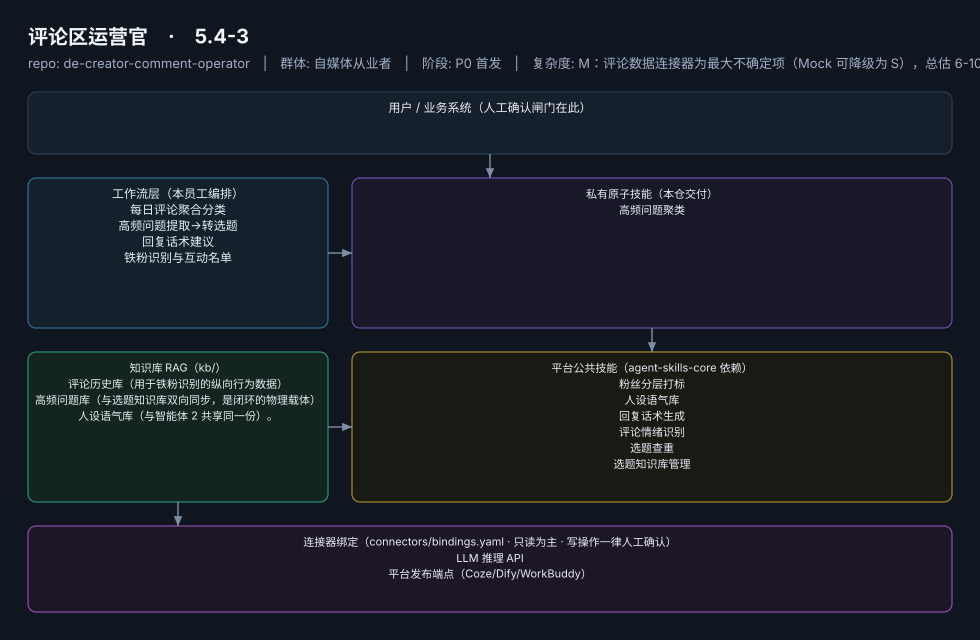

# 评论区运营官

> 把评论区从"成本中心"变成"选题矿藏"的运营副手
>
> **5.4-3**　·　自媒体从业者　·　阶段 P0 首发　·　
> 复杂度 M：评论数据连接器为最大不确定项（Mock 可降级为 S），总估 6-10 人日　·　¥30-60/月（据 R2 调研估算，蓝海无直接竞品）　·　定义卡 5.4-3



**一句话**：万粉以上创作者（评论量达到人工处理瓶颈的阈值）

---

## 这个数字员工解决什么问题

把评论区从"成本中心"变成"选题矿藏"的运营副手

| 项 | 内容 |
|---|---|
| 服务对象 | 万粉以上创作者（评论量达到人工处理瓶颈的阈值） |
| 可量化目标 | 评论处理时长从 1-2h 压缩至 ≤20 分钟；高频问题→选题转化率 ≥10%/周；回复人设一致性质检通过率 ≥95% |
| 投入产出 | 月省约 30h 折 ¥750-1200 + 闭环选题的复利价值，ROI >10 倍 |
| 需求依据 | D08、D01 |
| 分发渠道 | GitHub（必备基础渠道）、小红书、抖音、腾讯WorkBuddy Skill市场、Dify Marketplace |

## 30 秒上手

```bash
git clone <本仓库地址> && cd de-creator-comment-operator
pip install pyyaml
python3 tests/run.py            # 先跑一遍自检，确认环境与契约都对得上
```

试用（把 `<输入>` 换成本人真实材料）：

```text
请以「评论区运营官」的身份，帮我跑「每日评论聚合分类」。
材料如下：<输入>
要求：只使用材料里出现过的数字，缺的写 <待填>；对外文案停在待确认状态。
```

详细接入见 [`docs/01-安装与接入.md`](docs/01-安装与接入.md)。

## 仓库结构

```text
de-creator-comment-operator/
├── employee.yaml          # 机器契约（能力清单 + 依赖锁）
├── dependencies.yaml      # 对 core 的外部依赖（含版本）
├── persona/               # 运行提示词 / 边界 / KPI
├── skills/                # 私有原子技能（1 个）
├── spec-bindings/         # 有意不公共化能力的本地绑定声明（0 个）
├── workflows/             # 本员工工作流（4 条）
├── kb/                    # 知识库 RAG 契约
├── connectors/            # 连接器绑定（只读为主，写操作人工确认）
├── docs/                  # 六类发布文档
└── tests/                 # 自动化多场景测试
```

## 私有原子技能（1）

| 技能 | slug | 复杂度 | 阶段 | 成熟度 |
|---|---|---|---|---|
| `高频问题聚类` | `faq-clustering` | M | P0 | 契约完备 |

## 平台公共技能依赖（6）

| 技能 | slug | 全平台复用员工数 |
|---|---|---|
| `粉丝分层打标` | `fan-segment-tag` | 2 |
| `人设语气库` | `persona-tone-lib` | 2 |
| `回复话术生成` | `reply-copy-generator` | 3 |
| `评论情绪识别` | `review-sentiment-tag` | 5 |
| `选题查重` | `topic-duplicate-check` | 1 |
| `选题知识库管理` | `topic-kb-manage` | 3 |

> 这些技能来自 `agent-skills-core@1.0.0`，本仓库**只引用不复制**。

## Spec 绑定层（0）

（无）

> 这一族能力**有意不公共化**（与外部平台接口强绑定）。本仓不存正文，
> 只留本地绑定声明与连接器配置。

## 工作流（4）

| 工作流 | slug | 触发 | 阶段 | 调用技能数 |
|---|---|---|---|---|
| `每日评论聚合分类` | `wf-creator-comment-aggregate` | 定时（每日 21:00） | P0 | 1 |
| `高频问题提取→转选题` | `wf-creator-comment-qa-to-topic` | 事件（WF1 后自动） | P0 | 3 |
| `回复话术建议` | `wf-creator-comment-copy` | 人工/事件 | P0 | 2 |
| `铁粉识别与互动名单` | `wf-creator-comment-fan-tag` | 定时（每周） | P1 | 1 |

## 知识库与连接器

- 知识库语料：['评论历史库（用于铁粉识别的纵向行为数据）', '高频问题库（与选题知识库双向同步，是闭环的物理载体）', '人设语气库（与智能体 2 共享同一份）。']
- 连接器：LLM 推理 API、平台发布端点（Coze/Dify/WorkBuddy）

## 质量与验收

| 项 | 值 |
|---|---|
| 技能文件数 | 84 |
| 多场景用例数 | 168 |
| 用例通过 | 168 |
| 验收结论 | ✅ 通过 |

完整报告：[`docs/05-验收与测试.md`](docs/05-验收与测试.md)

## 许可

专有许可，详见 [`LICENSE`](LICENSE)。
