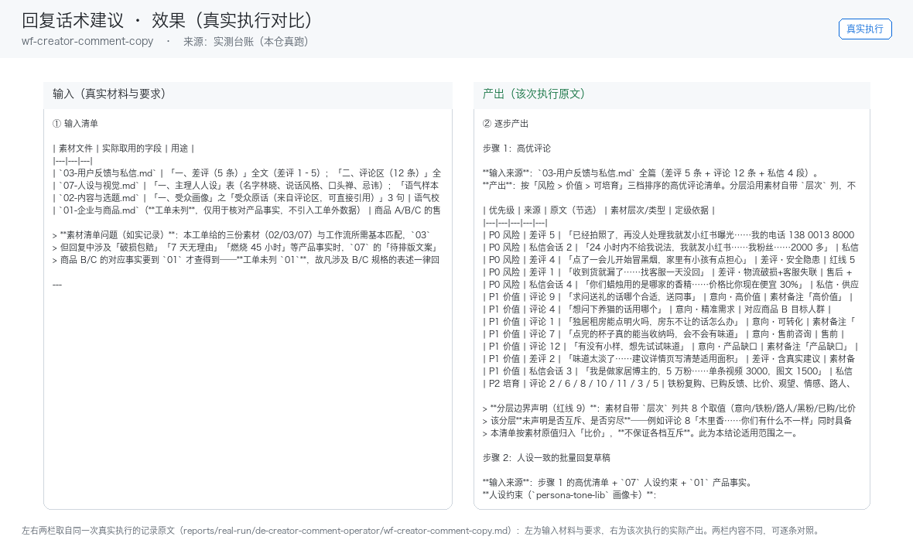

# 03 · 场景与价值

## 谁在用

万粉以上创作者（评论量达到人工处理瓶颈的阈值）

## 三个典型场景

### 场景 A：每日评论聚合分类
- **触发**：定时（每日 21:00）
- **之前**：人工从头做一遍，每次口径不一、结果不可比
- **之后**：拉取当日评论→提问/赞美/吐槽/黑粉四分→优先级排序
- **收益**：评论处理 1-2h→20min，月省约 30h×¥30≈¥900 vs ¥30-60

### 场景 B：高频问题提取→转选题
- **触发**：事件（WF1 后自动）
- **之后**：提问类评论聚类→高频问题榜→查重后写入选题库
- **收益**：**闭环核心**：评论区选题免费且精准，直接缓解第一痛点（选题枯竭）

### 场景 C：回复话术建议
- **触发**：人工/事件
- **之后**：高优评论→人设一致的批量回复草稿→人工确认发出
- **收益**：含于 WF1 工时；互动率提升带来流量加权的间接收益

## 价值构成

| 维度 | 说明 |
|---|---|
| 省时间 | 月省约 30h 折 ¥750-1200 + 闭环选题的复利价值，ROI >10 倍 |
| 提一致性 | 同一能力固化成技能，口径不再因人而异 |
| 降风险 | 业务红线写死在提示词里，越界即停 |
| 可审计 | 每个数字可回指输入，产出可追溯 |

## 与人工的边界

本员工**不替代决策**。它负责把重复劳动做成清单与初稿，
把决策点（要不要发、要不要改价、要不要道歉）留给人。

## 效果证据（真实执行）

**左输入 / 右产出**的对比图，取自一次真实执行（不是示意图、不是环境探测截图）：

| 证据 | 位置 |
|---|---|
| 完整台账（输入清单 + 逐步产出 + 质检 + 如实说明） | [`../reports/real-run/wf-creator-comment-copy.md`](../reports/real-run/wf-creator-comment-copy.md) |
| 效果对比图 | [`../workflows/wf-creator-comment-copy/docs/images/00-effect.png`](../workflows/wf-creator-comment-copy/docs/images/00-effect.png) |
| 终端回放 | [`../workflows/wf-creator-comment-copy/docs/images/04-terminal-run.png`](../workflows/wf-creator-comment-copy/docs/images/04-terminal-run.png) |
| 录屏（真实执行回放） | [`../workflows/wf-creator-comment-copy/docs/images/08-demo-run.gif`](../workflows/wf-creator-comment-copy/docs/images/08-demo-run.gif)　·　[`../workflows/wf-creator-comment-copy/docs/images/08-demo-run.mp4`](../workflows/wf-creator-comment-copy/docs/images/08-demo-run.mp4) |
| 使用示例（真实输入→输出） | [`../workflows/wf-creator-comment-copy/docs/使用示例.md`](../workflows/wf-creator-comment-copy/docs/使用示例.md) |

### 该次实测的判定

| 项 | 值 |
|---|---|
| 实测判定 | 通过 |
| 可用度 | 5/5 |
| 编造数字 | 0 处 |
| 红线命中 / 拦截 | 8 / 8 |
| 必需输入缺失已标注 | 7 处 |

> 该次执行用的是**模拟材料**（虚拟企业「拾光手作」）。换成你自己的材料需要重跑一遍——
> 数值纪律要求输出里每个数字都能在输入里找到出处，换材料后出处会变。
