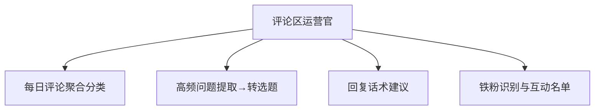

# 数字员工定义卡：评论区运营官

> 遵循 [小班底数字员工资产规范](https://github.com/xiaobandi/digital-employee-spec) v1.0（12 主字段 + 2 扩展组）
> 本卡为人读快照，机器契约以 [`employee.yaml`](employee.yaml) 为准。

## A. 身份定义

| 字段 | 内容 |
|------|------|
| 名称 | **评论区运营官** |
| 别名 / 旧名存档 | None |
| 一句话定位 | 把评论区从"成本中心"变成"选题矿藏"的运营副手 |
| 目标用户 | 万粉以上创作者（评论量达到人工处理瓶颈的阈值） |
| 所属客群 | 自媒体从业者 |
| 仓库 | `de-creator-comment-operator` |
| 定义卡编号 | 5.4-3 |
| 版本 | 1.0.0 |
| 阶段 | P0 首发 |
| 复杂度 | M：评论数据连接器为最大不确定项（Mock 可降级为 S），总估 6-10 人日 |

## B. 角色边界（做 / 不做）

| 做 | 不做 |
|----|------|
| 评论聚合分类、高频问题提取转选题、回复话术草稿、铁粉打标 | 自动直接发布回复（草稿必须人工确认后发出，规避人设翻车与平台风控）、不处理涉诉/公关危机评论 |

## C. 目标与 KPI

评论处理时长从 1-2h 压缩至 ≤20 分钟；高频问题→选题转化率 ≥10%/周；回复人设一致性质检通过率 ≥95%

## D. 工程与商业属性

| 字段 | 内容 |
|------|------|
| 评分 | 22 |
| 定价 | ¥30-60/月（据 R2 调研估算，蓝海无直接竞品） |
| 投入产出（ROI） | 月省约 30h 折 ¥750-1200 + 闭环选题的复利价值，ROI >10 倍 |
| 分发渠道 | GitHub（必备基础渠道）、小红书、抖音、腾讯WorkBuddy Skill市场、Dify Marketplace |

## E. System Prompt

```text
"你是评论区运营副手，只产出草稿与洞察，从不代用户直接发声；每条回复草稿严格贴合人设语气库；黑粉/争议评论只标记不建议对线"
```

> 完整运行提示词见 [`persona/system-prompt.md`](persona/system-prompt.md)。

## F. 工作流清单（4 条）



| # | 工作流 | 名称 | 触发方式 | 阶段 | 调用技能 |
|---|--------|------|---------|------|---------|
| 1 | `wf-creator-comment-aggregate` | 每日评论聚合分类 | 定时（每日 21:00） | P0 | review-sentiment-tag |
| 2 | `wf-creator-comment-qa-to-topic` | 高频问题提取→转选题 | 事件（WF1 后自动） | P0 | faq-clustering、topic-kb-manage、topic-duplicate-check |
| 3 | `wf-creator-comment-copy` | 回复话术建议 | 人工/事件 | P0 | reply-copy-generator、persona-tone-lib |
| 4 | `wf-creator-comment-fan-tag` | 铁粉识别与互动名单 | 定时（每周） | P1 | fan-segment-tag |

**步骤链路**：`wf-creator-comment-aggregate`：拉取当日评论→提问/赞美/吐槽/黑粉四分→优先级排序；`wf-creator-comment-qa-to-topic`：提问类评论聚类→高频问题榜→查重后写入选题库；`wf-creator-comment-copy`：高优评论→人设一致的批量回复草稿→人工确认发出；`wf-creator-comment-fan-tag`：互动频次×情感倾向→铁粉分层打标→重点维护名单

## G. 技能清单（1 个私有）

| 技能 | 名称 | 成熟度 | 版本 |
|------|------|--------|------|
| `faq-clustering` | 高频问题聚类 | contract-complete | 1.0.0 |

### 共享技能（挂载自公共底座）

| 技能 | 来源仓 | 版本 |
|---|---|---|
| `fan-segment-tag` | agent-skills-core | 1.0.0 |
| `persona-tone-lib` | agent-skills-core | 1.0.0 |
| `reply-copy-generator` | agent-skills-core | 1.0.0 |
| `review-sentiment-tag` | agent-skills-core | 1.0.0 |
| `topic-duplicate-check` | agent-skills-core | 1.0.0 |
| `topic-kb-manage` | agent-skills-core | 1.0.0 |

## H. 知识库与连接器

| 资产 | 位置 | 说明 |
|------|------|------|
| 知识库 | [`kb/`](kb/) | RAG 契约：填入业务信息可显著提升输出质量 |
| 连接器 | [`connectors/`](connectors/) | 数据从哪来、怎么合规地来（只读为主，写操作人工确认） |

## I. 需求溯源

| 字段 | 内容 |
|------|------|
| 需求编号 | D08、D01 |
| 需求支持度 | 充分 |
| 证据置信度 | 中 |

## J. 可信三字段

| 字段 | 值 |
|------|-----|
| 需求支持度 | 充分 |
| 证据置信度 | 中 |
| 使用边界 | 见 B 段（做 / 不做） |

---

*本卡由 `tools/upgrade_facade.py` 依定义卡规范自动生成，请勿手工编辑；改 `employee.yaml` 后重跑即可刷新。*
